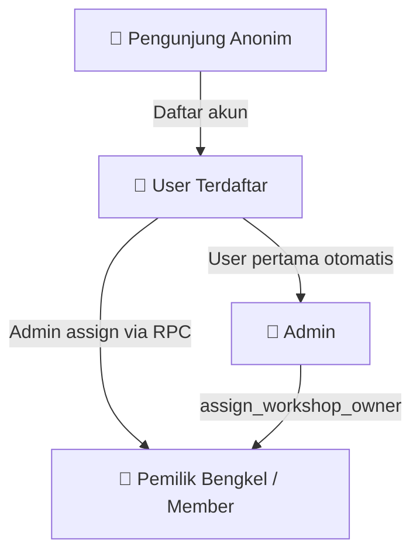
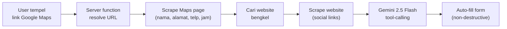
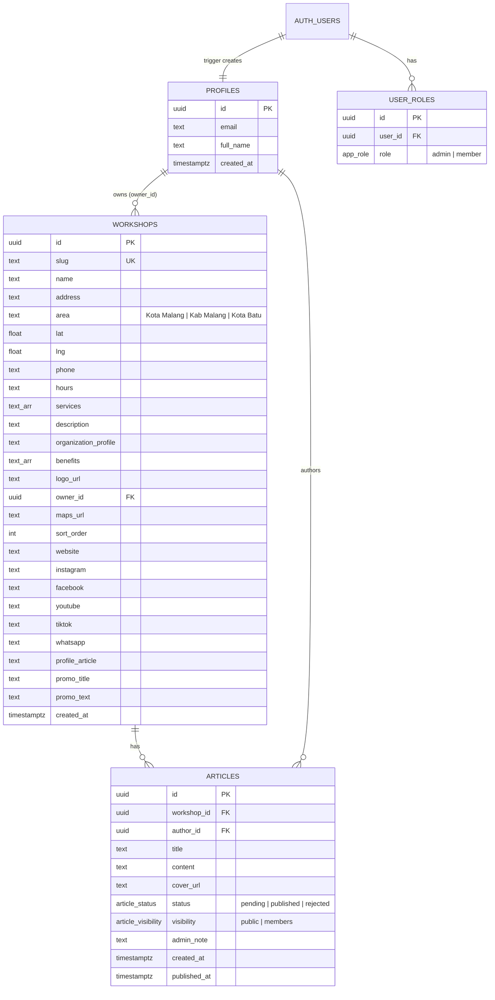
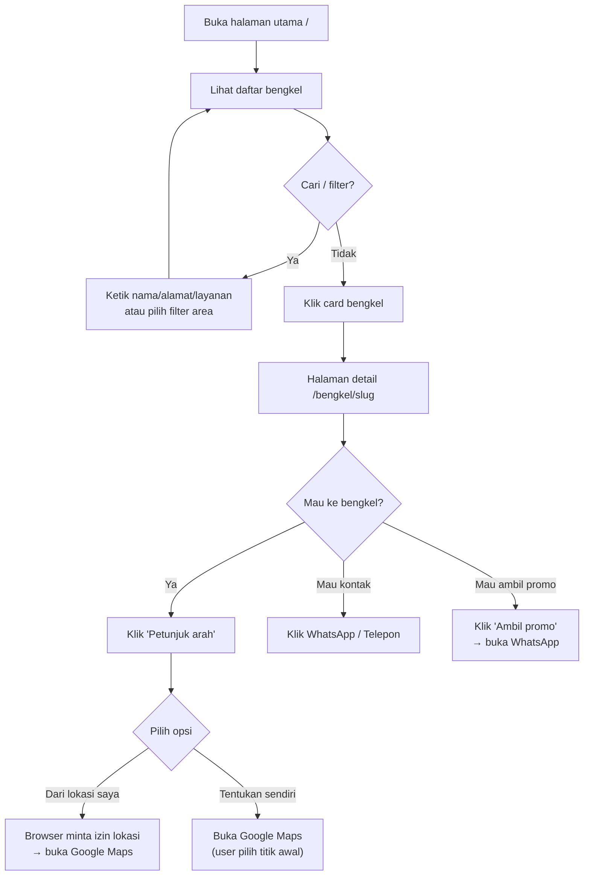
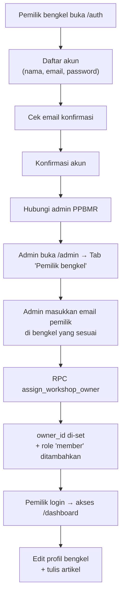
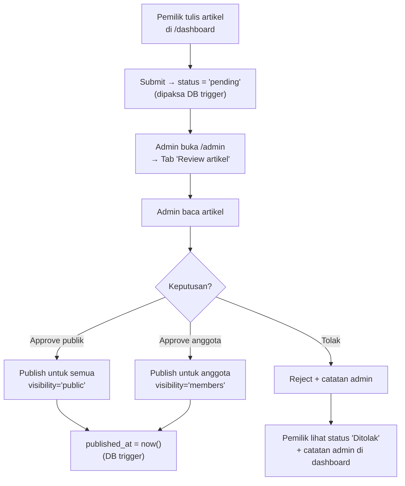
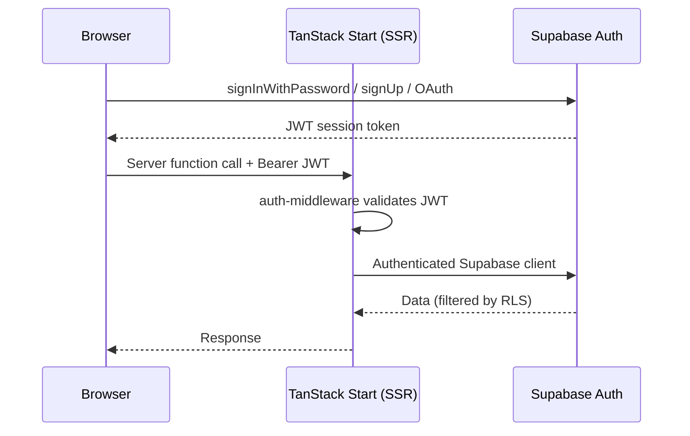
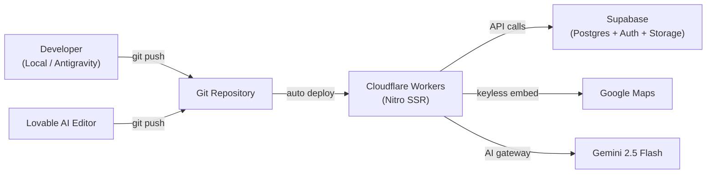

# PRD — PPBMR: Direktori Bengkel Malang Raya

**Versi:** 1.0  
**Tanggal:** 29 Oktober 2026  
**Status:** Current State Documentation  

---

## 1. Ringkasan Produk

**PPBMR** (Paguyuban Pemilik Bengkel Malang Raya) adalah platform web direktori bengkel mobil & motor untuk wilayah Malang, Batu, dan sekitarnya. Platform ini menghubungkan pemilik bengkel (anggota PPBMR) dengan masyarakat yang mencari bengkel terpercaya.

### 1.1 Problem Statement

Masyarakat Malang Raya kesulitan menemukan bengkel terpercaya yang sudah terverifikasi. Di sisi lain, pemilik bengkel anggota PPBMR tidak memiliki platform digital terpusat untuk menampilkan profil, layanan, dan promo mereka.

### 1.2 Solution

Platform direktori bengkel dengan fitur:
- 🔍 Pencarian & filter bengkel berdasarkan wilayah dan layanan
- 🗺️ Integrasi Google Maps untuk navigasi
- 📝 Sistem artikel dengan moderasi admin
- 👤 Dashboard pemilik bengkel untuk kelola profil
- 🤖 Autofill profil bengkel berbasis AI dari link Google Maps

### 1.3 Target Audience

| Segmen | Deskripsi |
|---|---|
| **Masyarakat umum** | Pemilik kendaraan di Malang Raya yang mencari bengkel |
| **Pemilik bengkel** | Anggota PPBMR yang ingin menampilkan profil bengkel mereka |
| **Admin PPBMR** | Pengurus organisasi yang mengelola direktori dan moderasi konten |

---

## 2. User Roles & Permissions



### 2.1 Role Matrix

| Capability | Anonim | User Terdaftar | Member / Pemilik | Admin |
|---|:---:|:---:|:---:|:---:|
| Lihat daftar bengkel | ✅ | ✅ | ✅ | ✅ |
| Cari & filter bengkel | ✅ | ✅ | ✅ | ✅ |
| Lihat profil bengkel | ✅ | ✅ | ✅ | ✅ |
| Petunjuk arah (Google Maps) | ✅ | ✅ | ✅ | ✅ |
| Baca artikel publik | ✅ | ✅ | ✅ | ✅ |
| Baca artikel khusus anggota | ❌ | ❌ | ✅ | ✅ |
| Edit profil bengkel sendiri | ❌ | ❌ | ✅ | ✅ |
| Tulis artikel | ❌ | ❌ | ✅ | ✅ |
| Review & publish artikel | ❌ | ❌ | ❌ | ✅ |
| Assign pemilik bengkel | ❌ | ❌ | ❌ | ✅ |
| Tambah/hapus bengkel | ❌ | ❌ | ❌ | ✅ |

### 2.2 Cara Mendapat Role

| Role | Mekanisme |
|---|---|
| **Admin** | User pertama yang mendaftar **otomatis jadi admin** (DB trigger). Tidak ada mekanisme lain. |
| **Member** | Admin menghubungkan email user ke bengkel via RPC `assign_workshop_owner` → otomatis insert role `member` |
| **Pemilik Bengkel** | Sama dengan Member — kepemilikan ditandai di kolom `workshops.owner_id` |

> [!IMPORTANT]
> Role system **sepenuhnya server-side** — ditegakkan oleh Row Level Security (RLS) dan database triggers. Tidak ada role check di client yang bisa dibypass.

---

## 3. Spesifikasi Fitur per Halaman

### 3.1 🏠 Halaman Utama — Daftar Bengkel (`/`)

**Tujuan:** Menampilkan seluruh bengkel anggota PPBMR dengan pencarian, filter, dan peta interaktif.

#### Layout

```
┌─────────────────────────────────────────────┐
│  [Hero Section]                             │
│  Badge "PPBMR" + Logo                       │
│  H1: "Rekomendasi Bengkel Mobil terbaik."   │
│  Subtitle: "{N} bengkel terpercaya..."      │
├─────────────────────────────────────────────┤
│  [🔍 Search Bar]  [Filter: Semua | Kota    │
│                     Malang | Kab Malang |   │
│                     Kota Batu]              │
├────────────────────────┬────────────────────┤
│  [Workshop Cards]      │  [Google Maps      │
│  - Logo + Nama         │   Embed iFrame]    │
│  - Alamat + Area       │                    │
│  - Telepon + Jam       │  Nama bengkel      │
│  - Service tags        │  [Rute ▼]          │
│  - [Profil] [Rute ▼]  │                    │
│  ...                   │                    │
└────────────────────────┴────────────────────┘
```

#### Data Source
- **Query:** `SELECT * FROM workshops ORDER BY sort_order ASC NULLS LAST, name ASC`
- **Filter/Search:** Client-side — filter by `area` + text match pada `name`, `address`, `services[]`

#### Interaksi User

| Aksi | Hasil |
|---|---|
| Ketik di search bar | Filter bengkel real-time (nama, alamat, layanan) |
| Klik filter area | Filter bengkel berdasarkan wilayah |
| Hover card bengkel | Highlight card + update peta ke lokasi bengkel tersebut |
| Klik nama bengkel | Buka Google Maps directions (new tab) |
| Klik "Profil" | Navigasi ke `/bengkel/{slug}` |
| Klik "Rute ▼" | Dropdown: "Dari lokasi saya" / "Tentukan titik awal sendiri" |
| Klik card (mobile) | Navigasi ke `/bengkel/{slug}` |

#### Responsiveness
- **Desktop (lg+):** 2 kolom — list kiri, peta kanan (sticky)
- **Mobile:** 1 kolom — hanya list, peta tersembunyi. Ada link "Lihat profil & benefit →"

---

### 3.2 🔧 Halaman Detail Bengkel (`/bengkel/{slug}`)

**Tujuan:** Menampilkan profil lengkap bengkel termasuk layanan, benefit, promo, artikel, dan kontak.

#### Layout

```
┌─────────────────────────────────────────────┐
│  [Hero Section - dark bg]                   │
│  Logo (besar) + Badge area                  │
│  H1: Nama Bengkel                           │
│  📍 Alamat lengkap                          │
│  [Petunjuk arah ▼]                          │
├────────────────────────┬────────────────────┤
│  [Profil Bengkel]      │  [Google Maps      │
│  Deskripsi organisasi  │   Embed iFrame]    │
│  Service tags          │                    │
│                        │  📞 Telepon        │
│  [Benefit Bengkel]     │  🕐 Jam buka       │
│  ✓ Benefit 1           │                    │
│  ✓ Benefit 2           │  [Social Links]    │
│  ✓ ...                 │  IG FB YT TT WA   │
│                        │                    │
│  [Tentang Bengkel]     │                    │
│  Artikel profil        │                    │
│  ┌─ Promo hari ini ──┐ │                    │
│  │ Judul promo       │ │                    │
│  │ Isi promo         │ │                    │
│  │ [Ambil promo →WA] │ │                    │
│  └───────────────────┘ │                    │
│                        │                    │
│  [Artikel dari bengkel]│                    │
│  - Judul artikel 1     │                    │
│  - Judul artikel 2     │                    │
└────────────────────────┴────────────────────┘
```

#### Data Source
- **Workshop:** `SELECT * FROM workshops WHERE slug = :slug`
- **Artikel:** `SELECT id, title, content, visibility, published_at FROM articles WHERE workshop_id = :id AND status = 'published' ORDER BY published_at DESC`

#### Sections (Conditional)

| Section | Tampil jika |
|---|---|
| Profil Bengkel | Selalu (gunakan `organization_profile` atau `description`) |
| Benefit | `benefits[]` tidak kosong |
| Tentang Bengkel | `profile_article` atau `promo_title/promo_text` ada |
| Promo | `promo_title` atau `promo_text` ada |
| Artikel | Ada artikel published untuk bengkel ini |
| Social Links | Minimal 1 social media URL terisi |

#### Promo CTA
- Tombol "Ambil promo" → buka link WhatsApp bengkel (new tab)
- Hanya tampil jika `whatsapp` URL tersedia

---

### 3.3 📰 Halaman Daftar Artikel (`/artikel`)

**Tujuan:** Menampilkan semua artikel yang telah dipublish dari berbagai bengkel.

#### Data Source
```sql
SELECT a.id, a.title, a.content, a.visibility, a.published_at,
       w.name, w.logo_url
FROM articles a
JOIN workshops w ON w.id = a.workshop_id
WHERE a.status = 'published'
ORDER BY a.published_at DESC
```

> [!NOTE]
> RLS secara otomatis memfilter: anonim hanya lihat `visibility='public'`, member bisa lihat `visibility='members'` juga.

#### Interaksi

| Aksi | Hasil |
|---|---|
| Klik card artikel | Navigasi ke `/artikel/{id}` |
| Badge 🔒 "Anggota" | Tampil pada artikel `visibility='members'` |

#### Conditional UI
- **Member:** Subtitle "Anda melihat artikel publik dan artikel khusus anggota."
- **Non-member:** Subtitle "Masuk sebagai anggota untuk membaca artikel khusus anggota."

---

### 3.4 📖 Halaman Detail Artikel (`/artikel/{id}`)

**Tujuan:** Menampilkan artikel lengkap.

#### Layout
```
┌─────────────────────────────────────────┐
│  [Logo bengkel] Nama Bengkel (→ link)   │
│  H1: Judul Artikel                      │
│  Status badge (jika bukan published)    │
│  [Cover image]                          │
│  Isi artikel (whitespace-pre-line)      │
└─────────────────────────────────────────┘
```

#### Error States
- Artikel tidak ditemukan: "Artikel tidak tersedia atau khusus anggota."
- Jika belum login: tampilkan link "Masuk" ke `/auth`

---

### 3.5 🔑 Halaman Auth (`/auth`)

**Tujuan:** Login dan registrasi user.

#### Auth Flows

````carousel
**Mode: Masuk (Login)**

| Field | Type | Validasi |
|---|---|---|
| Email atau username | text | Required |
| Kata sandi | password | Required, minLength 6 |

- Special: input `"pbmr malang raya"` → otomatis konversi ke `admin@ppbmr-malangraya.id`
- Method: `supabase.auth.signInWithPassword`
- Error: Toast dengan pesan error

<!-- slide -->
**Mode: Daftar (Register)**

| Field | Type | Validasi |
|---|---|---|
| Nama | text | Required |
| Email | email | Required |
| Kata sandi | password | Required, minLength 6 |

- Method: `supabase.auth.signUp` + `data.full_name`
- Sukses: Toast "Cek email Anda untuk konfirmasi akun."
- Error: Toast dengan pesan error

<!-- slide -->
**Google OAuth**

- Tombol "Lanjut dengan Google"
- Method: `lovable.auth.signInWithOAuth("google")`
- Menggunakan Lovable OAuth broker
````

#### Behavior
- Jika sudah login → redirect ke `/`
- Subtitle informatif: "Pemilik bengkel: daftar dulu, lalu admin akan menghubungkan akun Anda ke bengkel."

---

### 3.6 📊 Dashboard Pemilik Bengkel (`/dashboard`)

**Tujuan:** Pemilik bengkel mengelola profil bengkel dan menulis artikel.

**Akses:** Hanya user yang sudah di-assign sebagai pemilik bengkel.

#### Section A — Form Profil Bengkel

| Field | Type | Keterangan |
|---|---|---|
| Nama bengkel | text | |
| Wilayah | select | Kota Malang / Kabupaten Malang / Kota Batu |
| Alamat | text | Full-width |
| Link Google Maps | text | + tombol "Isi otomatis" 🤖 |
| URL logo bengkel | text | |
| Telepon | text | |
| Jam buka | text | |
| Layanan | textarea | 1 per baris, dipecah jadi array |
| Profil organisasi | textarea | |
| Deskripsi singkat | text | |
| Benefit | textarea | 1 per baris, dipecah jadi array |
| Website | text | |
| Instagram | text | |
| Facebook | text | |
| YouTube | text | |
| TikTok | text | |
| WhatsApp | text | |
| Artikel profil bengkel | textarea | 8 baris, long-form |
| Judul promo hari ini | text | |
| Isi promo hari ini | textarea | |

#### 🤖 Fitur AI Autofill



- **Trigger:** Paste link Google Maps + blur/klik "Isi otomatis"
- **Non-destructive:** Hanya mengisi field yang masih kosong
- **Model AI:** Gemini 2.5 Flash via Lovable AI gateway
- **Output AI:** nama, alamat, telepon, jam, layanan, benefit, profil organisasi, deskripsi, artikel profil (2-4 paragraf), judul promo, isi promo

#### Section B — Kelola Artikel

**Form tulis artikel:**

| Field | Type | Validasi |
|---|---|---|
| Judul | text | Required |
| URL gambar sampul | text | Optional |
| Isi artikel | textarea | Required |

- Submit → status otomatis `pending` (ditegakkan DB trigger, tidak bisa dibypass)
- Toast: "Artikel dikirim untuk review."

**Daftar artikel saya:**

| Status | Badge | Warna |
|---|---|---|
| Published (publik) | "Terbit · Semua" | Primary (biru) |
| Published (anggota) | "Terbit · Anggota" | Primary (biru) |
| Pending | "Menunggu review" | Secondary (abu) |
| Rejected | "Ditolak" | Signal (kuning/merah) |

- Jika ada `admin_note` → tampilkan "Catatan admin: ..."

---

### 3.7 👑 Panel Admin (`/admin`)

**Tujuan:** Admin mengelola konten dan membership.

**Akses:** Hanya user dengan role `admin`.

#### Tab 1: Review Artikel (Default)

Menampilkan artikel `status = 'pending'`.

Per artikel:
```
┌─────────────────────────────────────────┐
│  Nama Bengkel · tanggal · Badge status  │
│  H3: Judul Artikel                      │
│  [Isi artikel - scrollable, max 10rem]  │
│                                         │
│  [Catatan untuk bengkel: ___________]   │
│                                         │
│  [🌐 Publish semua] [🔒 Publish        │
│   anggota] [✕ Tolak]                   │
└─────────────────────────────────────────┘
```

| Aksi | Efek |
|---|---|
| "Publish untuk semua" | `status='published'`, `visibility='public'`, `published_at=now()` |
| "Publish untuk anggota" | `status='published'`, `visibility='members'`, `published_at=now()` |
| "Tolak" | `status='rejected'` + `admin_note` tersimpan |

#### Tab 2: Semua Artikel

Sama seperti Tab 1, tapi menampilkan **semua artikel** (semua status). Admin bisa re-publish atau re-reject artikel yang sudah diproses.

#### Tab 3: Pemilik Bengkel

Menampilkan semua bengkel dengan kemampuan assign pemilik.

```
┌─────────────────────────────────────────┐
│  Nama Bengkel (bold)                    │
│  Pemilik saat ini: email@... / "Belum   │
│  ada pemilik"                           │
│  [Email pemilik: ___________] [Simpan]  │
└─────────────────────────────────────────┘
```

- **Assign:** Isi email → Simpan → RPC `assign_workshop_owner` → set `owner_id` + insert role `member`
- **Unassign:** Kosongkan email → Simpan → set `owner_id = null`
- **Validasi:** User harus sudah terdaftar. Jika email tidak ditemukan → error "Pengguna dengan email tersebut belum terdaftar"

---

## 4. Database Schema

### 4.1 Entity-Relationship Diagram



### 4.2 Enums

| Enum | Values | Keterangan |
|---|---|---|
| `app_role` | `admin`, `member` | Role user dalam sistem |
| `article_status` | `pending`, `published`, `rejected` | Status moderasi artikel |
| `article_visibility` | `public`, `members` | Siapa yang bisa baca artikel |

### 4.3 Database Triggers

| Trigger | On | Behavior |
|---|---|---|
| `handle_new_user` | AFTER INSERT `auth.users` | Buat profil + user pertama otomatis admin |
| `guard_article_status` | BEFORE INSERT/UPDATE `articles` | Non-admin: paksa `status='pending'`, hapus `published_at` |
| `guard_workshop_owner` | BEFORE UPDATE `workshops` | Non-admin tidak bisa ubah `owner_id` |

### 4.4 RPC Functions

| Function | Parameter | Behavior |
|---|---|---|
| `has_role` | `(user_id, role)` | Cek apakah user punya role tertentu |
| `is_member` | `(user_id)` | Cek apakah user admin/member/pemilik bengkel |
| `assign_workshop_owner` | `(workshop_id, email)` | Admin-only. Set pemilik bengkel + insert role member |

### 4.5 Row Level Security (RLS)

| Tabel | Operasi | Siapa | Kondisi |
|---|---|---|---|
| **workshops** | SELECT | Semua | Public read |
| | INSERT | Admin | `has_role(uid, 'admin')` |
| | UPDATE | Pemilik / Admin | `owner_id = uid OR admin` |
| | DELETE | Admin | `has_role(uid, 'admin')` |
| **articles** | SELECT (publik) | Semua | `status='published' AND visibility='public'` |
| | SELECT (anggota) | Member | `status='published' AND visibility='members' AND is_member(uid)` |
| | SELECT (own) | Auth | `author_id = uid OR admin` |
| | INSERT | Auth | `author_id = uid AND (workshop owner OR admin)` |
| | UPDATE | Auth | `author_id = uid OR admin` |
| | DELETE | Auth | `author_id = uid OR admin` |
| **profiles** | SELECT | Auth | Own profile OR admin |
| | INSERT | Auth | Own profile only |
| | UPDATE | Auth | Own profile only |
| **user_roles** | SELECT | Auth | Own roles OR admin |

---

## 5. User Flows

### 5.1 Flow Pengunjung Mencari Bengkel



### 5.2 Flow Pendaftaran Pemilik Bengkel



### 5.3 Flow Moderasi Artikel



---

## 6. Navigasi & Header

### 6.1 Site Header

```
┌──────────────────────────────────────────────────────┐
│ ▬▬▬▬▬▬▬▬▬▬▬▬▬ signal-colored stripe ▬▬▬▬▬▬▬▬▬▬▬▬▬ │
│ [Logo] PPBMR                                         │
│ "Bengkel terbaik dan terpercaya | Malang Raya"       │
│                                                      │
│ Daftar Bengkel | Artikel | [Bengkel Saya] | [Admin]  │
│                                          [Masuk/Keluar]│
└──────────────────────────────────────────────────────┘
```

| Nav Item | Visible to | Route |
|---|---|---|
| Daftar Bengkel | Semua | `/` |
| Artikel | Semua | `/artikel` |
| Bengkel Saya | Member/Pemilik | `/dashboard` |
| Admin | Admin | `/admin` |
| Masuk | Belum login | `/auth` |
| Keluar | Sudah login | Sign out → `/` |

### 6.2 Sitemap

```
/                       ← Daftar bengkel (home)
/bengkel/{slug}         ← Detail bengkel
/artikel                ← Daftar artikel
/artikel/{id}           ← Detail artikel
/auth                   ← Login / Register
/dashboard              ← Dashboard pemilik bengkel (protected)
/admin                  ← Panel admin (protected)
```

---

## 7. Komponen Shared

### 7.1 DirectionsMenu (Dropdown Navigasi)

| Opsi | Behavior |
|---|---|
| "Dari lokasi saya saat ini" | Request browser geolocation → buka Google Maps dengan origin |
| "Tentukan titik awal sendiri" | Buka Google Maps tanpa origin (user pilih sendiri) |

- Error handling: toast jika geolocation ditolak/gagal
- Loading spinner saat mendapatkan lokasi

### 7.2 SocialLinks (Pill Buttons)

| Platform | Ikon | Warna BG |
|---|---|---|
| Instagram | FaInstagram | Signal |
| Facebook | FaFacebook | Primary |
| YouTube | FaYoutube | Signal |
| TikTok | FaTiktok | Foreground |
| WhatsApp | FaWhatsapp | Primary |
| Website | FaGlobe | Secondary |

Hanya render platform yang URL-nya terisi.

### 7.3 WorkshopLogo

- Jika `logo_url` ada → tampilkan gambar
- Fallback → 2 huruf inisial dari nama bengkel + signal-colored dot

---

## 8. Security Model

> [!CAUTION]
> Semua aturan keamanan ditegakkan di **level database** (RLS + triggers), bukan di client. Client-side checks hanya untuk UX (sembunyikan tombol), bukan untuk keamanan.

### 8.1 Prinsip Keamanan

| Prinsip | Implementasi |
|---|---|
| Article moderation tamper-proof | DB trigger `guard_article_status` paksa `status='pending'` untuk non-admin |
| Owner assignment admin-only | RPC `assign_workshop_owner` cek `has_role(uid, 'admin')` |
| Owner_id immutable by non-admin | DB trigger `guard_workshop_owner` revert perubahan `owner_id` |
| Members-only content | RLS policy cek `is_member(uid)` |
| Server function auth | JWT validation via `requireSupabaseAuth` middleware |
| CSRF protection | CSRF middleware pada server functions |

### 8.2 Auth Flow (Technical)



---

## 9. Technical Architecture

### 9.1 Stack Overview

| Layer | Technology |
|---|---|
| **Frontend** | React 19 + TypeScript 5.8 |
| **SSR Framework** | TanStack Start + Nitro |
| **Routing** | TanStack Router (file-based) |
| **UI** | Tailwind CSS v4 + shadcn/ui + Radix UI |
| **Data Fetching** | TanStack Query v5 |
| **Forms** | React Hook Form + Zod |
| **Database** | PostgreSQL (Supabase) |
| **ORM** | Drizzle (migrations only) |
| **Auth** | Supabase Auth + Google OAuth |
| **Maps** | Google Maps (keyless embeds) |
| **AI** | Gemini 2.5 Flash (autofill via Lovable gateway) |
| **Build** | Vite 8 + Rolldown + Bun |
| **Deploy** | Lovable Cloud → Cloudflare Workers |

### 9.2 Deployment Architecture



---

## 10. Data Seed (Initial State)

**11 bengkel** di 3 wilayah:

| Wilayah | Bengkel |
|---|---|
| **Kota Malang** | Sumber Jaya Motor, Arjuna Auto Service, Dinoyo Motor Sport, Sawojajar Jaya Motor, Bengkel Bunul, AAS Aspawi Auto Service |
| **Kabupaten Malang** | Kepanjen Teknik, Singosari Oto Care, Lawang Garage, Bengkel Samudro |
| **Kota Batu** | Batu Sentosa Bengkel |

> [!NOTE]
> **CCR Auto Service** direferensikan di migration 0002-0003 (sort_order + social/promo data) tapi INSERT-nya tidak ada di migration files — kemungkinan ditambahkan via aplikasi atau migration terpisah.

---

## 11. Known Limitations & Future Considerations

| Area | Current State | Potensi Improvement |
|---|---|---|
| **Workshop creation** | Admin-only, via Supabase dashboard atau RPC | Form create bengkel di admin panel |
| **Image upload** | Hanya URL (text field) | Upload file ke Supabase Storage |
| **Article editor** | Plain textarea | Rich text editor (Tiptap/ProseMirror) |
| **Search** | Client-side filter | Full-text search di database |
| **Analytics** | Tidak ada | View count, click tracking |
| **Notifications** | Tidak ada | Email/push ketika artikel di-review |
| **Multi-language** | Hanya Bahasa Indonesia | i18n support |
| **PWA** | Tidak ada | Offline support, install prompt |
| **Google OAuth** | Via Lovable broker | Direct Supabase OAuth provider |
